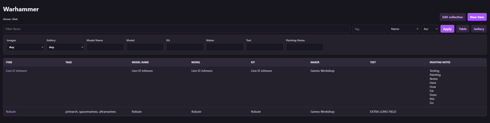
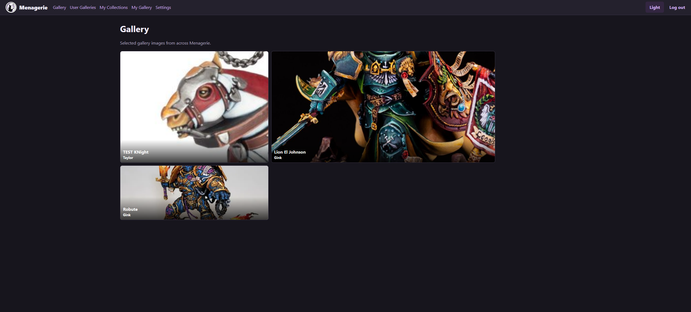

# Menagerie

Menagerie is a self-hosted web app for managing collections of physical items. It provides username/password login, admin/collector/viewer roles, collection ownership, custom fields, table and gallery views, filtering, sorting, tags, item detail pages, and multiple image uploads per item.

## Screenshots



The collection view shows a wide, filterable table for a single collection. Custom fields become sortable columns, and the advanced filters let you narrow items by image status, gallery status, tags, and field values while keeping large collections horizontally scrollable.



The gallery view displays selected item images as visual tiles. Each tile highlights the item name and owner, using the saved crop and gallery layout so collectors can present selected items as a browsable showcase.

## Run Locally

```powershell
python -m venv .venv
.\.venv\Scripts\Activate.ps1
pip install -r requirements.txt
$env:MENAGERIE_SECRET_KEY="change-this"
$env:MENAGERIE_ADMIN_USERNAME="admin"
$env:MENAGERIE_ADMIN_PASSWORD="admin123"
$env:MENAGERIE_ALLOW_INSECURE_DEFAULTS="1"
python app.py
```

Open `http://localhost:8000`.

Uploaded images and the SQLite database are stored in `data/` by default. In the container, data is stored at `/app/data`.

## Build The Container

Make sure Docker Desktop or your Docker daemon is running first.

```powershell
docker build -t menagerie:latest .
```

Run it locally:

```powershell
docker run --rm -p 8000:8000 `
  -e MENAGERIE_SECRET_KEY="change-this" `
  -e MENAGERIE_ADMIN_USERNAME="admin" `
  -e MENAGERIE_ADMIN_PASSWORD="admin123" `
  -e MENAGERIE_ALLOW_INSECURE_DEFAULTS="1" `
  -v menagerie-data:/app/data `
  menagerie:latest
```

## Reverse Proxy

Menagerie is designed to run behind an HTTPS reverse proxy such as nginx. The app trusts standard proxy headers when `MENAGERIE_PROXY_FIX=1`, which is enabled by default.

Recommended container environment for public HTTPS:

```text
MENAGERIE_SECRET_KEY=use-a-long-random-secret
MENAGERIE_ADMIN_USERNAME=your-admin-user
MENAGERIE_ADMIN_PASSWORD=change-this-password
MENAGERIE_DATA_DIR=/app/data
MENAGERIE_SESSION_COOKIE_SECURE=1
MENAGERIE_PROXY_FIX=1
```

Minimal nginx location:

```nginx
location / {
    proxy_pass http://127.0.0.1:8000;
    proxy_set_header Host $host;
    proxy_set_header X-Real-IP $remote_addr;
    proxy_set_header X-Forwarded-For $proxy_add_x_forwarded_for;
    proxy_set_header X-Forwarded-Proto $scheme;
    client_max_body_size 32m;
}
```

For public deployments, keep `/app/data` on persistent storage and back it up regularly. Menagerie refuses to run with the default secret key and refuses first-start admin creation with the default `admin/admin123` credentials unless `MENAGERIE_ALLOW_INSECURE_DEFAULTS=1` is set.

## Push To zot

The zot registry catalog is available at:

```text
http://192.168.0.245:8568/v2/_catalog
```

Tag and push the image:

```powershell
docker tag menagerie:latest 192.168.0.245:8568/menagerie:latest
docker push 192.168.0.245:8568/menagerie:latest
```

If Docker refuses the registry because it is HTTP instead of HTTPS, add it to Docker's insecure registries configuration:

```json
{
  "insecure-registries": ["192.168.0.245:8568"]
}
```

Restart Docker, then run the `docker push` command again.

## Runtime Environment

| Variable | Default | Purpose |
| --- | --- | --- |
| `MENAGERIE_SECRET_KEY` | `dev-change-me` | Flask session signing key. Set this in production. |
| `MENAGERIE_ADMIN_USERNAME` | `admin` | Initial admin username created when no admin exists. |
| `MENAGERIE_ADMIN_PASSWORD` | `admin123` | Initial admin password created when no admin exists. |
| `MENAGERIE_DATA_DIR` | `/app/data` in Docker | Directory for SQLite data and uploads. |
| `MENAGERIE_SESSION_COOKIE_SECURE` | `0` | Set to `1` when served through HTTPS. |
| `MENAGERIE_SESSION_COOKIE_SAMESITE` | `Lax` | Session cookie SameSite policy. |
| `MENAGERIE_PROXY_FIX` | `1` | Trust one layer of `X-Forwarded-*` proxy headers. |
| `MENAGERIE_ALLOW_INSECURE_DEFAULTS` | unset | Set to `1` only for throwaway local development. |

Change the default admin password immediately after first deployment by creating a new admin user and retiring the bootstrap credentials.

## Mini Scan API and item identity

Users can create and revoke up to five active credentials in **Settings → Manage API keys** (`/settings/api-keys`). A key is shown once, stored only as a SHA-256 digest, and authenticates requests with `Authorization: Bearer <key>`. API access is limited to the key owner's collections, including for administrators; viewer accounts cannot upload items. Existing browser forms still require CSRF tokens.

The Mini Scan companion in `../menagerie_capture` uses these endpoints:

| Endpoint | Purpose |
|---|---|
| `GET /api/v1/me` | Authenticated account identity |
| `GET /api/v1/collections` | Owned collections, ordered custom field definitions, core fields, and required-edit issues |
| `GET /api/v1/items/by-rfid/<uid>` | Find an existing owned item and its web edit URL |
| `POST /api/v1/collections/<id>/items` | Create one item with ordered finalized photos |

Creation uses multipart form data: `metadata` is a JSON object containing `item_uuid`, `rfid_uid`, `name`, `description`, `tags` (comma-separated), and `values` (field ID strings mapped to values). Repeated `images` parts specify display order. At least one image and a valid 4/7/10-byte RFID UID are required. Custom field values are validated against current definitions. Images are decoded, orientation-corrected, and re-encoded to JPEG; malformed images are rejected. The per-image limit is 40 megapixels, with at most 30 selected photos.

Send a UUID `Idempotency-Key` header. Retrying the same request with identical metadata and image bytes returns the original item; changed payloads or duplicate RFID/UUID assignments return 409. A failed database transaction removes its newly written images. If an uploaded item was deleted, retrying does not resurrect it. Keys are never accepted via query parameters. API replies use `Cache-Control: no-store`.

Every item has a unique UUID after migration. The web item form can create an untagged item with an automatically generated UUID, then attach/replace its RFID UID or change its UUID later. Existing items receive UUIDs automatically; duplicating an item produces a new UUID without copying its RFID association. API-created Mini Scan items require an RFID tag. RFID UID and UUID uniqueness currently apply across the installation.

### Collection requirements

Name, Description, Tags and ordered photos are built-in item properties rather than custom collection fields. Name, RFID UID and one selected photo are required for Mini Scan uploads. The exact additional mandatory collection field list is pending product confirmation; no arbitrary fields are added to existing collections.

To declare mandatory **existing custom fields** and their exact types, configure a JSON mapping, for example:

```sh
MENAGERIE_MINI_SCAN_REQUIRED_FIELDS='{"Manufacturer":"text","Painted":"checkbox"}'
```

This example is not enabled by default. Supported types are `text`, `multiline`, `number`, `date`, `timestamp`, `url`, and `checkbox`. A missing field, ambiguous duplicate name, or wrong type produces an actionable issue list and collection edit URL. Mini Scan displays the list and directs the user to edit the collection. Required non-checkbox values must be nonempty; an unchecked required checkbox is a valid `false` value. Field definitions are checked again when uploading.

### Running the update

Install the updated requirements and restart Menagerie through your existing deployment process. Migrations 14 and 15 add API credentials and item identities without dropping existing data. The request-body limit defaults to 128 MiB to accommodate a six-photo upload and is configurable with `MENAGERIE_MAX_UPLOAD_MB`; configure the reverse proxy's upload limit consistently. Mini Scan requires HTTPS for remote servers; HTTP is supported for localhost development. Server updates do not require reflashing the Pico.

Tests: `.venv/bin/python -m unittest discover -s tests`. Tests use temporary databases and uploads.
